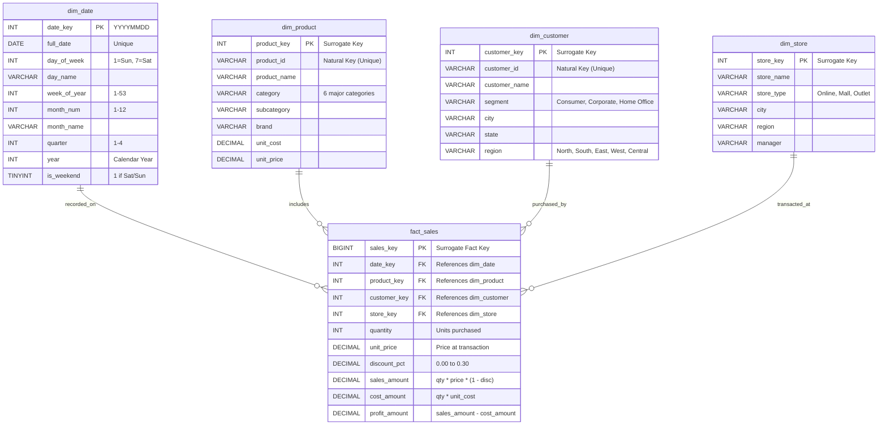

# 🌟 Star Schema Architecture & Dimensional Design

## 1. Overview
The `sales_dw` database implements a classic dimensional Star Schema optimized for online analytical processing (OLAP), reporting, and decision-support systems.

At the core is the **`fact_sales`** table representing discrete transactional events (order line items), surrounded by four conformed dimension tables providing analytical context:
- **`dim_date`**: Time dimension covering 24 consecutive months down to daily grain with calendar hierarchies.
- **`dim_product`**: Product catalog across 6 major merchandising categories and brands.
- **`dim_customer`**: Customer demographic profiles, segments (Consumer, Corporate, Home Office), and geographic location.
- **`dim_store`**: Retail channel entities (Online portals, Mall locations, and Outlet venues).

---

## 2. Mermaid Entity Relationship Diagram (ERD)

---

## 3. Grain of the Fact Table
- **Grain**: **One row per product per order line item.**
- Every row captures the sale of a specific product quantity sold to a customer at a given store location on a specific calendar date.
- Additive metrics: `quantity`, `sales_amount`, `cost_amount`, `profit_amount` can be aggregated across any dimension without double-counting.

---

## 4. Star Schema vs. 3NF (Normalized) OLTP Design

| Characteristic | Star Schema (OLAP) | Normalized 3NF (OLTP) |
|---|---|---|
| **Primary Goal** | High-speed analytical queries, aggregations, and business intelligence | Fast, transactional writes, concurrency, and eliminating update anomalies |
| **Number of Joins** | Minimal (typically 1 fact joined to 1-4 dimension tables) | High (joins across 10-25 tables to assemble an invoice or report) |
| **Query Complexity** | Simple, intuitive SQL with standard GROUP BY / Window functions | Complex queries with deep subqueries, self-joins, and junction tables |
| **Data Redundancy** | Controlled denormalization in dimensions (e.g. category name stored directly) | Zero redundancy (tables strictly normalized up to 3rd normal form) |
| **Indexing Strategy** | Fact foreign keys, composite range indexes, and covering indexes | B-tree indexes focused on single-row lookups and primary keys |
| **Optimizer Execution** | Predictable hash joins and star-join transformations | Complex nested loops and multi-table join trees |
